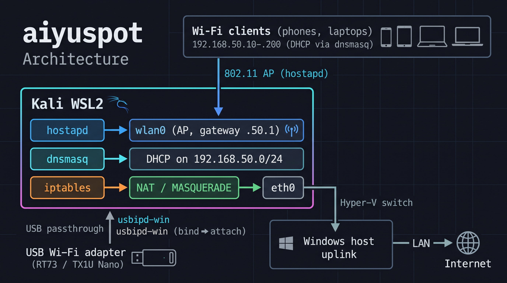

# 🌐 aiyuspot

<p align="center">
  <strong>Turn a Windows PC into a Wi-Fi hotspot using a USB adapter — powered by Kali WSL2 and usbipd-win.</strong>
</p>

<p align="center">
  <a href="LICENSE"></a>
  <a href="https://github.com/teeprakorn1/aiyuspot"></a>
  <a href="https://github.com/teeprakorn1/aiyuspot"></a>
</p>

---

**aiyuspot** passes a USB Wi-Fi adapter through to **Kali WSL2** via `usbipd-win`. Inside WSL, Kali runs `hostapd` (AP mode), `dnsmasq` (DHCP), and `iptables` NAT to route traffic out through the PC's existing network uplink. Wireless clients simply see and connect to a standard Wi-Fi network. 

> 💡 **Zero Host Pollution:** No changes are made to your Windows networking configuration — the entire routing and AP stack lives cleanly inside WSL2.

---

## 📌 Contents

- [Architecture](#%EF%B8%8F-architecture)
- [Features](#-features)
- [Supported Adapters](#-supported-adapters)
- [Quick Start](#-quick-start)
- [CLI Usage](#-cli-usage)
- [Security Notes](#%EF%B8%8F-security-notes)
- [Troubleshooting](#%EF%B8%8F-troubleshooting)
- [Repository Layout](#-repository-layout)
- [Contributing](#-contributing)
- [License](#-license)

---

## 🏗️ Architecture



> 📐 **Deep dive:** [docs/architecture.md](docs/architecture.md) — layered view, control/data planes, and failure domains.

<details>
<summary>🔍 <strong>View ASCII Architecture Diagram</strong></summary>

```text
     Wi-Fi clients (phones, laptops)
       192.168.50.10–.200  (DHCP via dnsmasq)
                 │
                 ▼  802.11 AP (hostapd)
┌─────────────────────────────────────────────────┐
│                  Kali WSL2                      │
│                                                 │
│   hostapd ──► wlan0  (AP, gateway .50.1)        │
│   dnsmasq ──► DHCP on 192.168.50.0/24           │
│   iptables ──► NAT/MASQUERADE ──► eth0 ─────────┼──┐
└────────────▲────────────────────────────────────┘  │ Hyper-V
             │ USB passthrough                       │ switch
   usbipd-win (bind → attach)                        ▼
             │                               ┌───────────────┐
     USB Wi-Fi adapter                       │ Windows host  │──► LAN ──► Internet
     (RT73 / TX1U Nano)                      │ uplink        │
                                             └───────────────┘
```
</details>

---

## ✨ Features

- 🔒 **Multiple Security Modes:** Supports **WPA2-PSK** (recommended, using stock `/usr/sbin/hostapd`), legacy **WEP** (5/13-char), and **Open** AP modes (using a custom `/usr/local/sbin/hostapd-wep`).
- ⌨️ **Dual Interface:** Includes both an interactive arrow-key menu UI and a full CLI. `wifi-control.bat` is completely portable and runs from any directory (`%~dp0` + `wslpath`).
- 🔌 **Automated Passthrough:** Automatically detects supported adapters and executes `usbipd bind ➔ attach ➔ start`.
- 🩺 **Diagnostics & Recovery:** Built-in adapter/driver health reporting (`check`) and automated stuck-PnP state recovery (`reset`).
- 🛠️ **Driver Builder:** Includes an automated out-of-tree driver build script (`driver`) for AIC8800-based adapters (TX1U Nano).

---

## 📡 Supported Adapters

| Adapter | USB ID | Driver | Status |
| :--- | :---: | :---: | :--- |
| **Ralink RT73** *(54M USB)* | `148f:2573` | `rt73usb` *(custom kernel)* | ✅ **Verified** — all modes client-tested (WPA2 auto-falls back to TKIP) |
| **TP-Link Archer TX1U Nano** *(AX300, Wi-Fi 6)* | `3625:0110` <br>*(Storage: `a69c:5721`)* | `aic8800_fdrv` | ✅ **Verified** — AP works (WPA2 / WEP / Open) |

> ➕ **Adding another adapter:** Simply add its `VID:PID` to `wifi-control.bat` and `scripts/check-adapters.ps1`. See [docs/adapters.md](docs/adapters.md) for detailed instructions.

---

## 🚀 Quick Start

> 📦 **Full setup guide:** [SETUP.md](SETUP.md) — end-to-end installation from scratch.

### 1. Install Prerequisites
Ensure you have WSL2 with a `kali-linux` distribution and [usbipd-win](https://github.com/dorssel/usbipd-win) installed on Windows. Inside Kali, install the required packages (`hostapd`, `dnsmasq`, `iw`, `iptables`, `usb-modeswitch`), the `rt73.bin` firmware, and build the `fwserve` helper. Note that the RT73 adapter also requires a custom WSL2 kernel compiled with `rt73usb` support.
* 📖 **Setup Guides:** [docs/prerequisites.md](docs/prerequisites.md) · [docs/kernel-build.md](docs/kernel-build.md) · [CHANGELOG.md](CHANGELOG.md)

### 2. Launch the Hotspot
Run `wifi-control.bat` (it will automatically self-elevate via UAC to manage `usbipd bind`). Select **Start WPA2 AP** from the interactive menu, or launch it directly via CLI:
```bat
wifi-control.bat wpa2 MyNet MyPass123
```

### 3. Connect Your Devices
Join the newly broadcast SSID from your client devices. They will automatically receive an IP address in the `192.168.50.x` range via DHCP (Gateway: `192.168.50.1`).

> ⚠️ **Important:** Always change the default credentials before using the hotspot in a live environment. See [Security Notes](#️-security-notes) below.

---

## 💻 CLI Usage

```bat
wifi-control.bat                        :: Launch interactive arrow-key menu
wifi-control.bat default                :: Start WEP AP (SSID: aiyuspot / Key: aiyu1)
wifi-control.bat open                   :: Start Open AP (SSID: aiyuspot)
wifi-control.bat wep MyNet abcde        :: Start WEP AP (Key must be 5 or 13 ASCII chars)
wifi-control.bat wpa2 MyNet MyPass123   :: Start WPA2-PSK AP (Passphrase >= 8 chars)
wifi-control.bat stop                   :: Stop AP, detach USB, and terminate Kali WSL
wifi-control.bat check                  :: Run adapter & driver health report
wifi-control.bat driver                 :: Build and install AIC8800 driver in Kali (TX1U)
wifi-control.bat kernel                 :: Build and install custom WSL2 kernel with rt73usb (RT73)
wifi-control.bat reset                  :: Execute destructive PnP recovery (see warning)
```

**Network Configuration:**
* **Subnet:** `192.168.50.0/24`
* **DHCP Pool:** `192.168.50.10` – `192.168.50.200`
* **Gateway / DNS:** `192.168.50.1`

---

## 🛡️ Security Notes

* **Use WPA2:** WEP is cryptographically broken and Open mode provides zero encryption. Both are included strictly for testing or connecting vintage/legacy hardware.
* **Change Default Credentials:** The default SSID (`aiyuspot`), WEP key (`aiyu1`), and WPA2 passphrase (`aiyuspot`) are publicly documented in this repository.
* **Administrator Privileges:** The launcher requests UAC administrator elevation on Windows to execute `usbipd bind` operations.
* **`reset` is Destructive:** The `reset` command purges device registry keys under `HKLM\SYSTEM\CurrentControlSet\Enum` via a temporary `SYSTEM`-level scheduled task and clears `usbipd` state records. Only run this when an adapter is severely stuck in a broken Windows PnP state. Review the header in `scripts/reset-rt73.ps1` for full details.
* **Modifies the WSL VM init namespace:** For the TX1U, the launcher stages AIC8800 firmware into the VM init `/lib/firmware` and disables a firmware-abort udev stub (`50-firmware.rules`) there via `wsl --system` + `nsenter`. This affects all WSL2 distros on the machine and persists across restarts.
* **Authorized Networks Only:** Only operate this tool on networks you own or have explicit permission to administer, as it bridges external Wi-Fi clients directly onto your host machine's network uplink.

---

## 🛠️ Troubleshooting

| Symptom | Resolution |
| :--- | :--- |
| **`Device busy (exported)`** or **Code 19** after reboot | Run `wifi-control.bat reset`, then physically unplug and replug the USB adapter. |
| **`No supported adapter found`** | Run `wifi-control.bat check` and verify that the device is detected under `usbipd list`. |
| **`rfkill` warning** inside WSL | Harmless WSL2 virtualized hardware limitation — safe to ignore. |
| **Kernel module missing** after WSL/kernel update | Re-run `wifi-control.bat driver` (for TX1U) or rebuild/reinstall the `rt73usb` kernel modules (for RT73). |
| **TX1U shows a CD-ROM / access-denied dialog** | Normal — that's its storage-mode personality (`a69c:5721`). Click **Cancel**; the launcher mode-switches it automatically. |
| **`usb_modeswitch: No devices in default mode found`** or `lsusb` hangs in Kali | A stale ghost USB device is wedging the stack. Run `wifi-control.bat stop`, then `usbipd detach --all`, then retry. (v0.1.1+ auto-`rmmod`s stale modules before attach.) |
| **`No devices found with hardware-id 3625:0110`** | The mode-switch didn't take — unplug and replug the TX1U, then start again. |

---

## 📂 Repository Layout

```text
├── SETUP.md                 # End-to-end installation guide
├── CHANGELOG.md             # Release history (Keep a Changelog)
├── wifi-control.bat         # Main entry point — interactive menu & CLI (portable)
├── wifi-menu.ps1            # PowerShell arrow-key menu interface (v0.1.1)
├── scripts/                 # Windows-side utilities
│   ├── check-adapters.ps1   # Adapter and driver health diagnostic script
│   └── reset-rt73.ps1       # Stuck-PnP recovery utility (SYSTEM registry purge)
├── kali/
│   ├── kali-wsl-hotspot.sh  # Orchestrates hostapd, dnsmasq, and iptables NAT in Kali
│   └── driver/
│       ├── install-aic8800.sh  # Compiles aic8800_fdrv driver with patched VID:PID (TX1U)
│       └── install-rt73.sh     # Builds custom WSL2 kernel with rt73usb (RT73)
├── fwserve/
│   └── fwserve.c            # sysfs firmware fallback daemon (serves rt73.bin in WSL2)
└── docs/
    ├── architecture.md      # Layered architecture, control/data planes, failure domains
    ├── prerequisites.md     # Windows host and Kali WSL2 setup instructions
    ├── kernel-build.md      # Guide for compiling a custom WSL2 kernel with rt73usb
    ├── adapters.md          # Hardware notes and guide for adding new VID:PIDs
    ├── benchmarks.md        # Measured throughput/latency and how to reproduce
    └── images/
        └── e2e-architecture.jpg
```

---

## 🤝 Contributing

Issues and Pull Requests are welcome! We are especially looking for:
* Open-mode test results for the **TP-Link Archer TX1U Nano** (WPA2 and WEP are verified).
* Support and `VID:PID` additions for new USB Wi-Fi adapters (see [docs/adapters.md](docs/adapters.md)).

---

## 📜 License

Distributed under the **MIT License**. See [LICENSE](LICENSE) for full details.