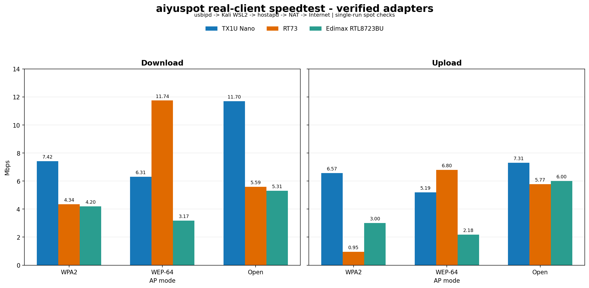
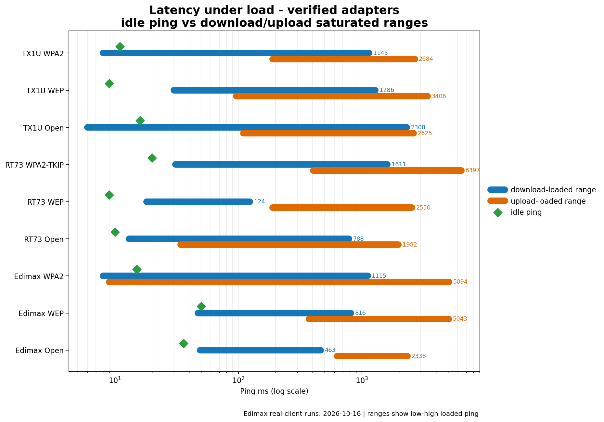

# 📊 Benchmarks

Measured throughput and latency of the **aiyuspot** hotspot chain:

```
Wi-Fi client → USB adapter → usbipd (URB over TCP) → Kali WSL2
  → hostapd (nl80211) → ip_forward → iptables-legacy MASQUERADE
  → eth0 → Hyper-V vSwitch → Windows uplink → Internet
```

> Numbers are single-run spot checks on the maintainer's machine — not a
> controlled lab benchmark. See [Reproduce](#-reproduce) to run your own.

---

## 🧪 Test Environment

| Component | Value |
| :--- | :--- |
| Adapters under test | TP-Link Archer TX1U Nano (`3625:0110`, `aic8800_fdrv`); Ralink RT73 (`148f:2573`, `rt73usb`); Edimax EW-7611ULB (`7392:a611`, `rtl8xxxu`) |
| Kernel | `6.18.40.1-microsoft-standard-WSL2+` (custom build) |
| AP mode | WPA2-PSK (CCMP) / WEP / Open, 2.4 GHz ch 6, `hw_mode=g` |
| Hotspot subnet | `192.168.50.0/24` — DHCP `192.168.50.10–200` via `dnsmasq` |
| NAT | `MASQUERADE` on `eth0` (double-NAT through WSL2) |
| Client | Mobile device, WPA2-PSK, real-world RF conditions |
| Test tool | speedtest.net (multi-connection) |

---

## 📈 Results — 2026-10-15

### Throughput — verified adapters



*RT73 "WPA2" uses TKIP fallback (rt73usb hardware crypto rejects CCMP key
install). TX1U and Edimax WPA2 runs use CCMP. All bars are real-client
speedtest runs; Edimax values are from 2026-10-16.*

### Latency — idle vs loaded



Latency stays low while idle (~10 ms on TX1U/RT73; 15–50 ms on Edimax)
but balloons once the link saturates —
classic bufferbloat amplified by the usbipd hop and the host uplink being
the bottleneck. Not great for latency-sensitive workloads under load.

---

## 📋 Raw numbers — TX1U Nano

| Metric | WPA2-PSK | WEP-64 | Open |
| :--- | ---: | ---: | ---: |
| **Download** | 7.42 Mbps | 6.31 Mbps | 11.70 Mbps |
| **Upload** | 6.57 Mbps | 5.19 Mbps | 7.31 Mbps |
| **Idle ping** | 11 ms | 9 ms | 16 ms |
| **Loaded ping (download)** | ~8–1145 ms, jitter 466 ms | ~30–1286 ms, jitter 280 ms | ~6–2308 ms, jitter 584 ms |
| **Loaded ping (upload)** | ~189–2684 ms, jitter 1446 ms | ~96–3406 ms, jitter 1415 ms | ~110–2625 ms, jitter 1530 ms |

*All runs: real mobile client, multi-connection speedtest, same chain.*

**Verdict:** ✅ works for browsing, messaging, SD video. Latency under load
is high — expected: every packet crosses USB-over-TCP (usbipd) plus a
double NAT, and the host uplink itself is the ceiling.

---

## 🔍 Where the throughput goes

The adapter is 2.4 GHz Wi-Fi 6 — raw PHY is far above 7 Mbps. The chain
narrows it down:

| Hop | Cost | Mitigation |
| :--- | :--- | :--- |
| Host uplink | Hard ceiling — test was bounded by it | Use a faster uplink |
| usbipd URB-over-TCP | Per-URB latency, limited queue depth | Fixed for now — it's the transport |
| WSL2 NAT (`eth0`) + in-Kali NAT | Double NAT adds a few ms | Could bridge instead, breaks isolation |
| 2.4 GHz ch 6 congestion | Shared band, co-channel interference | Try channels 1/11, or a 5 GHz adapter (a phy without Band 1 auto-picks `hw_mode=a` ch 36) |
| `hw_mode=g` in hostapd conf | Caps PHY at 54 Mbps legacy rates | Enable `ieee80211n`/`ieee80211ax` IEs — needs hostapd conf changes; TX1U untested |

---

## 🧾 RT73 — 2026-10-15

Measured on the custom WSL2 kernel (`install-rt73.sh` build), same
chain as above, all three modes, real mobile client:

| Metric | WEP-64 | Open | WPA2-TKIP |
| :--- | ---: | ---: | ---: |
| **Download** | 11.74 Mbps | 5.59 Mbps | 4.34 Mbps |
| **Upload** | 6.80 Mbps | 5.77 Mbps | 0.95 Mbps |
| **Idle ping** | 9 ms | 10 ms | 20 ms |
| **Loaded ping (download)** | ~18–124 ms, jitter 54 ms | ~13–788 ms, jitter 49 ms | ~31–1611 ms, jitter 159 ms |
| **Loaded ping (upload)** | ~189–2550 ms, jitter 1546 ms | ~34–1982 ms, jitter 157 ms | ~403–6397 ms, jitter 712 ms |

*(WPA2 run used TKIP — rt73usb's hw crypto rejects CCMP key install;
the script auto-falls back. WPA2-TKIP runs are uplink/noise-sensitive —
treat the numbers as "works" rather than a ceiling.)*

Faster than the TX1U in the WEP run, though slower in WPA2 and Open
download — the RT73 does its WEP/crypto in
hardware (rt73 MAC cipher engine), while the TX1U path pays per-frame
costs through the aic8800 firmware. Loaded-ping is also noticeably
tamer on the download side, matching the lower sustained rate.

AP `AP-ENABLED` verified on the new kernel for **Open, WEP, and WPA2**
— note WPA2 uses an automatic **TKIP fallback**: `rt73usb`'s hardware
crypto rejects CCMP key installation (`nl80211: key addition failed`),
so the script retries with `rsn_pairwise=TKIP` when CCMP fails.

---

## 📡 Edimax EW-7611ULB — 2026-10-16

RTL8723BU/`rtl8xxxu` real-client runs on the same chain as above and
custom kernel `6.18.40.1`. Firmware arrived via the `fwserve` sysfs
fallback (direct initns load still returned `-2`).

| Metric | WPA2-PSK | WEP-64 | Open |
| :--- | ---: | ---: | ---: |
| **Download** | 4.20 Mbps | 3.17 Mbps | 5.31 Mbps |
| **Upload** | 3.00 Mbps | 2.18 Mbps | 6.00 Mbps |
| **Idle ping** | 15 ms | 50 ms | 36 ms |
| **Loaded ping (download)** | ~162 ms avg (8–1115 ms) | ~333 ms avg (47–816 ms) | ~163 ms avg (49–463 ms) |
| **Loaded ping (upload)** | ~596 ms avg (9–5094 ms, jitter spikes) | ~1678 ms avg (374–5043 ms) | ~1095 ms avg (632–2338 ms) |

*(WPA2 host uplink: AIS, Bangkok. WEP-64 host uplink: 3BB, Bangkok.
Open host uplink: True Online, Nonthaburi.
Numbers are single-run spot checks, bound by the 1T1R 11n PHY under
`hw_mode=g`, the usbipd hop, and the host uplink itself.)*

All three modes are functional for real client Internet access. WEP
and Open are legacy/insecure; use WPA2 for normal operation.

*Edimax loaded-ping values are shown as average plus observed low-high
range; the earlier TX1U/RT73 tables show the low-high range and jitter.*

---

## 🔁 Reproduce

```bat
wifi-control.bat provision
wifi-control.bat wpa2 <SSID> <PASS>
wifi-control.bat wep <SSID> <5-or-13-char-key>
wifi-control.bat open <SSID>
```

Run `provision` once per adapter on a prepared `kali-linux` WSL2
installation; it installs the profile's packages, firmware, and driver
requirements. Then on a client device:

1. Join the SSID, confirm IP is `192.168.50.x`
2. Run https://www.speedtest.net or `iperf3` against a public server
3. For pure Wi-Fi throughput (uplink excluded), run `iperf3 -s` inside Kali
   (`wsl -d kali-linux -u root -- iperf3 -s`) and point the client at
   `192.168.50.1` — the hotspot gateway is the WSL guest itself

Additions welcome via PR — especially runs on the other registry
adapters (rtl8xxxu siblings, MediaTek, rtw88), any 5 GHz-capable
dongle (all verified adapters are 2.4 GHz-only), and `iperf3`
Wi-Fi-local numbers.
